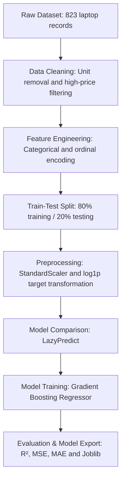

# Laptop Price Prediction


## Project Overview

A machine learning regression project designed to predict laptop prices based on hardware specifications and product characteristics. The project covers exploratory data analysis, data preprocessing, feature engineering, model comparison, and performance evaluation.

## Dataset

| Attribute | Value |
|---|---:|
| Raw records | 823 |
| Raw columns | 19 |
| Test split | 20% |

The dataset includes laptop brands, processor specifications, RAM capacity, storage capacity, operating systems, graphics cards, and product prices.

## Machine Learning Workflow



## Model Performance

| Metric | Test score |
|---|---:|
| R² Score | 0.8693 |
| MSE | 0.0258 |
| MAE | 0.1162 |

| Parameter | Value |
|---|---|
| Selected model | Gradient Boosting Regressor |
| Test size | 20% |
| Target transformation | Log1p |
| Random state (split) | 15 |
| Random state (model) | 42 |

All reported metrics were calculated on the log-transformed target. Predictions are converted back to the original price scale using `expm1`.

## Technologies

- Python
- Pandas & NumPy
- Scikit-learn
- Matplotlib & Seaborn
- LazyPredict
- Joblib
- Jupyter Notebook

## Repository Structure

```text
laptop-price-prediction/
├── Laptop Price Predict/
│   ├── Data/
│   │   ├── laptopPrice_data.csv
│   │   └── laptop_data_cleaned.csv
│   ├── Models/
│   │   └── laptop_model.pkl
│   ├── notebook/
│   │   └── RegressionHomework.ipynb
│   └── requirements.txt
└── README.md
```

## Getting Started

Clone the repository:

```bash
git clone https://github.com/blgmstf332/laptop-price-prediction.git
cd laptop-price-prediction
```

Install the required packages:

```bash
pip install pandas numpy matplotlib seaborn scikit-learn lazypredict joblib jupyter
```

Launch Jupyter Notebook:

```bash
jupyter notebook
```

Open `RegressionHomework.ipynb` from the notebook directory. Update the dataset path to `../Data/laptopPrice_data.csv` when running from that directory.

## Limitations & Future Improvements

- Fit all data-dependent preprocessing steps on training data only.
- Remove the generated row-index feature.
- Perform model selection using cross-validation rather than the held-out test set.
- Export preprocessing and the regression model as a unified pipeline.
- Evaluate MAE and RMSE on the original price scale.
- Correct the dependency file and improve reproducibility.

## Author

**Mustafa Kılıç**

Computer Engineering Student — Artificial Intelligence, Machine Learning & Data Science

[GitHub](https://github.com/blgmstf332)
